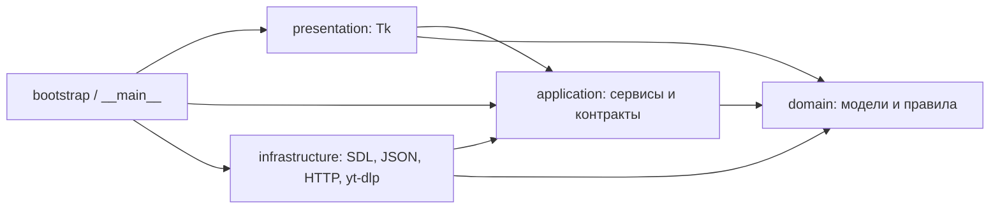

# Архитектура YT 1.0

YT — настольное приложение с разделением моделей, сценариев использования, внешних
адаптеров и Tk-интерфейса. Направление зависимостей проверяется тестами.

## Пакеты

| Путь | Ответственность |
| --- | --- |
| `src/yt/domain/` | Треки, очередь без повторов, состояния плеера, настройки, сообщения и запросы загрузки. Только стандартная библиотека. |
| `src/yt/application/ports.py` | Контракты аудио, настроек, библиотеки, обложек и загрузки. |
| `src/yt/application/playback.py` | Команды плеера: play/pause, next/previous, seek, shuffle, обновление библиотеки. |
| `src/yt/application/controllers.py` | Фоновые сценарии загрузки, предпросмотра, сканирования библиотеки и обложек. |
| `src/yt/application/tasks.py` | Владение фоновыми задачами и сигнал завершения приложения. |
| `src/yt/infrastructure/` | Реализации контрактов: pygame/SDL, Mutagen, JSON, requests, yt-dlp, пути ресурсов и журнал. |
| `src/yt/presentation/` | Главное окно, отдельные представления загрузок/библиотеки/плеера, общие виджеты и тема. |
| `src/yt/bootstrap.py` | Сборка конкретных адаптеров и сервисов. Зависимости передаются в окно явно. |
| `src/yt/__main__.py` | Параметры командной строки, журналирование и жизненный цикл приложения. |
| `scripts/` | Сборка релиза, экспорт иконок и ручная сетевая проверка. |
| `tests/` | Регрессии, архитектурные ограничения, тесты настроек, контроллеров и интерфейса. |
| `public/` | Все исходные и экспортированные визуальные ассеты. |

## Правила зависимостей

1. `domain` не импортирует другие слои и внешние библиотеки.
2. `application` зависит от моделей и `Protocol`, а не от Tk, pygame или yt-dlp.
3. `infrastructure` реализует контракты приложения.
4. `presentation` вызывает сервисы и работает с виджетами. Она не читает JSON,
   не декодирует MP3, не обращается к HTTP и не создаёт потоки.
5. Новые конкретные адаптеры подключаются в `bootstrap.py`.

Виджеты вынесены отдельно: библиотека и панель плеера не импортируют главное окно.
В корне оставлен небольшой совместимый запускатель `app.py`. Сборщик перенесён
в `scripts/build_release.py`, чтобы имя `build.py` не перекрывало стандартный пакет PyPA `build`.

## Потоки и события

Tk и аудиокоманды вызываются из основного потока. Фоновые операции отправляют
`AppEvent` через потокобезопасную очередь; окно обрабатывает её через `after()`.
Фоновая задача не получает ссылку на Tk-виджеты.

Новый запрос предпросмотра/библиотеки отменяет предыдущий. Токены дополнительно
защищают интерфейс от запоздавших ответов. Контроллер загрузки предотвращает повторный
старт и публикует завершающее событие даже при неожиданной ошибке адаптера.

Для MP3 используется ограниченный пул из 1–6 потоков. У каждого трека свой экземпляр
yt-dlp и свои callbacks. Блокировки на ID видео предотвращают запись одного файла
двумя потоками. Доступ к архиву синхронизирован до окончания записи и flush.
Отмена кооперативная: текущий сетевой запрос или FFmpeg могут завершиться перед выходом.

## Очередь воспроизведения

`PlaybackQueue` хранит посещённые треки, оставшуюся очередь и историю. Переключение
shuffle и обновление библиотеки не очищают посещённые треки. После окончания прохода
плеер останавливается. Новый проход начинается явной командой. Ручной выбор трека
и переход назад считаются намеренным повтором.

`Player` зависит от `AudioOutput`. В тестах используется `FakeBackend`; SDL
инициализируется только при первом воспроизведении, поэтому старт приложения
не требует аудиоустройства.

## Настройки и ресурсы

Настройки остаются в `%LOCALAPPDATA%\YT\settings.json`; схема совместима с 0.x.
Неверные поля заменяются значениями по умолчанию, неизвестные поля сохраняются.
Запись выполняется через уникальный временный файл рядом с целевым и атомарную замену.
Повреждённый JSON не перезаписывается при чтении.

Журнал: `%LOCALAPPDATA%\YT\logs\yt.log`, ротация по 2 МБ, три резервные копии.
Импорты пакета не запускают UI, сеть, аудио или настройку глобального журнала.

В checkout ассеты находятся в `public/`, в wheel — в `share/yt/public`, в PyInstaller
— в каталоге ресурсов сборки. `infrastructure/runtime.py` скрывает различия.

## Проверки и ограничения

Архитектурные тесты проверяют импорты. GUI-сценарии выполняются в отдельных процессах,
чтобы изолировать глобальное состояние Tcl/SDL на Windows. Обычные тесты не обращаются
к YouTube. Ручная сетевая проверка запускается отдельно через `scripts/check_download.py`.

Этот рефакторинг не вводит плагины, базу данных, веб-сервер или контейнер DI. Для
настольного приложения достаточно обычных Python-объектов, явных контрактов и composition root.
